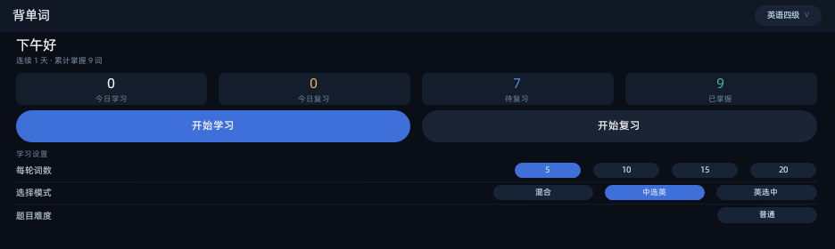
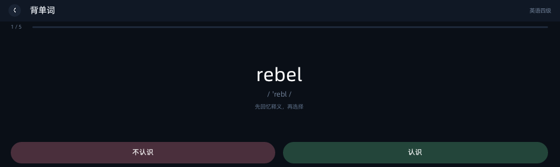
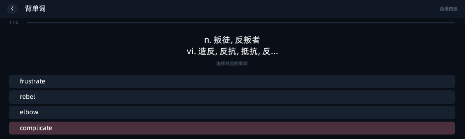
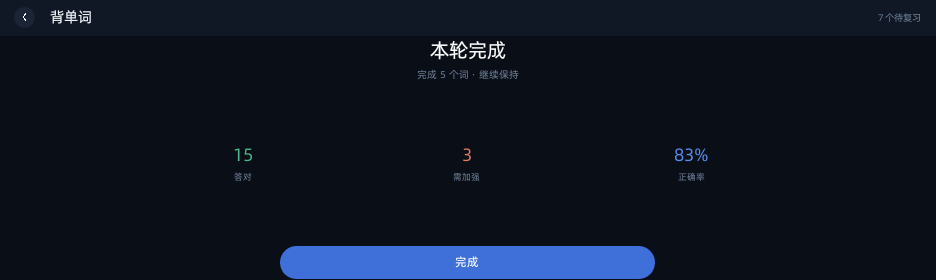

# 背单词 · 有道词典笔 PenOS 版

把 PenMods QML 插件 `words_plugin`（Qt/QML，320x170）移植为有道词典笔 **Falcon / QuickJS mini-app**（PenOS）。深色现代界面，全部尺寸用视口单位，跨机型自适应。



## 功能

- **三本词库**：英语四级 1635 词 / 高考英语 2123 词 / 高中英语词组-维基词典 249 词，合计 4007 条，内置离线可查
- **学习**：先自评「认识 / 不认识」再露出释义，认识的词本轮需累计答对 2 次、不认识的需 4 次，未达标随机插回队列
- **巩固**：学习队列走完自动进入四选一，答对变绿自动下一题，答错标红留在本题
- **结算**：答对 / 需加强 / 正确率三栏统计，一键回首页
- **续学**：中途退出保存会话，下次启动弹「继续上次学习 / 重新开始」
- **设置**：每轮词数 5/10/15/20、选择模式（混合 / 中选英 / 英选中）、题目难度（高难优先）

| 学习 | 巩固 | 结算 |
| --- | --- | --- |
|  |  |  |

## 快速开始

需要[有道词典笔 Falcon 运行环境](https://github.com/)：一台已开 adb 的词典笔 + Node 16。

```bash
# 1. 安装依赖（构建工具链）
npm install

# 2. 静态校验（26 项：appid、页注册、词库完整性、无 px、无 emoji 等）
npm run check

# 3. 构建，产出 <appid>.1_1_0.amr
npm run build

# 4. 安装到设备（构建产物落在 data/ 目录，已随仓库提供现成包）
adb push data/8000000000765868.1_1_0.amr /data/local/tmp/w.amr
adb shell "miniapp_cli uninstall 8000000000765868"
adb shell "miniapp_cli install /data/local/tmp/w.amr"
adb shell "miniapp_cli start 8000000000765868"
```

> `tools/build.js` 默认用 `D:/penos/.tools/node16/.../node.exe` 跑 aiot-vue-cli，路径写在脚本顶部，换机器请改 `NODE_BIN` / `CLI` 常量，或直接 `npx aiot-vue-cli build -c -q -p --dir .`。

## 目录结构

```
src/
  app.js                 应用入口，$falcon.useDefaultBasePageClass
  app.json               页面注册 / appid / 版本
  pages/index/index.vue  单页承载 首页 / 续学 / 学习 / 巩固 / 结算 / 词库选择 六视图
  services/engine.js     学习与复习状态机
  services/store.js      全局存储（storage.getGlobalStorage 优先，旧档自动归一）
  services/metrics.js    视口尺寸工具
  assets/dicts/*.json    三份词库（导出自源插件 SQLite）
assets/back.png          返回箭头（必须放工程根 assets/，构建只同步 libs / jsworkers / assets）
tools/                   export-dicts.js / check.js / build.js / gen_icons.py
data/                    构建产物 AMR（可直接 adb install 的现成包）
shots/                   真机走查截图
```

## 交互逻辑（对齐源插件 QML）

1. **学习**：先选「不认识 / 认识」→ 露出释义 → 点「继续」提交。选择「认识」的词需在本次会话内累计答对 2 次，「不认识」需 4 次；未达标则随机插回剩余队列，达标移出。同一个词最多出现 target+3 次，保证会话必然结束。
2. **巩固**：学习队列走完后自动进入四选一。答对变绿并在 820ms 后进入下一题；答错标红并留在本题可继续点。
3. **结算**：答对 / 需加强 / 正确率，点「完成」回首页。
4. **续学**：`store.js` 持久化 `session`，再次启动检测到未完成会话即弹窗。

## 实现要点 / 踩过的坑

- **不使用固定像素**：所有尺寸用 `vh` / `vw` 视口单位。Weex 的 `height: %` 依赖父节点定高、`font-size: %` 相对父元素字体，实测会整屏白，故一律用视口单位。
- **不用 emoji**：词典笔无 emoji 字体，全部替换为 PNG 图标，`tools/check.js` 有门禁。
- **按压反馈**：用 `@touchstart` / `@touchend` + `.pressed { opacity: 0.5 }` 的 JS 状态实现，不依赖 `:active`。
- **Weex 布局坑**：纵向 flex 容器里再套一层 view 包按钮会得到零高度、完全不渲染 —— 按钮必须是 flex 容器的直接子节点。
- **词库文本**：源 SQLite 里存的是字面两字符反斜杠 n 而非换行，`tools/export-dicts.js` 导出时归一为真换行。
- **复习选项乱序**：`engine.choices()` 按当前词 id 缓存一次选项顺序，避免渲染与判题各洗一次牌导致「点对判错」。

## 真机调试备忘

- 截图：`adb shell "hal-screen on; hal-screen keep"` 点亮屏幕后 `miniapp_cli capture /data/local/tmp/x.png` 才是真实画面，休眠时只有噪点图。
- 点击：`send_event touch press A B`，其中 **A = 截图像素 y，B = 935 - 截图像素 x**；每改一次布局都要用 PIL 重新扫像素带取中心。
- 日志：`/userdata/applog/DictPen_<日期>_<时分秒>.log`，本应用行形如 `(console(8000000000765868).warn.0)`。
- 批量点击脚本要先 `miniapp_cli start` 拉回前台，点击间隔 0.7~1.0s，过快会误触系统输入法。

## 已知限制

- 源插件的调度算法编译在 `libwords_plugin.so`（AArch64 / Qt5，无 C++ 源码），无法逐行复用，学习节奏按源 QML 的可见交互重建。
- 「高难词优先」按历史错误次数降序排序，语义等价但实现是重写的。
- appid `8000000000765868` 为本地随机分配值。

## 许可

MIT。词库数据来自源插件 `words_plugin` 的 SQLite（四级 / 高考 / 维基词典词组），版权归原作者。
